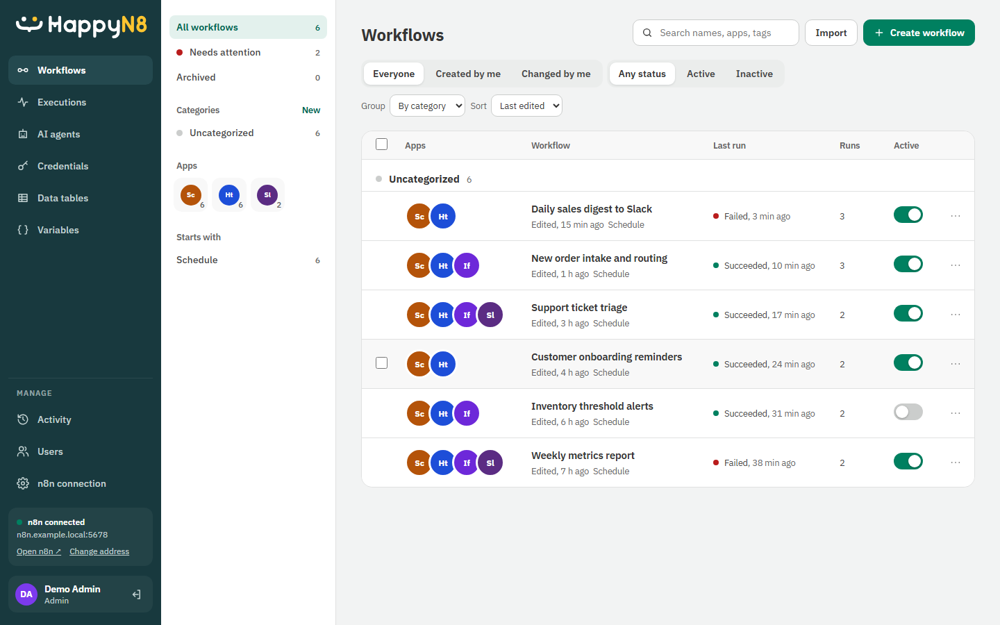
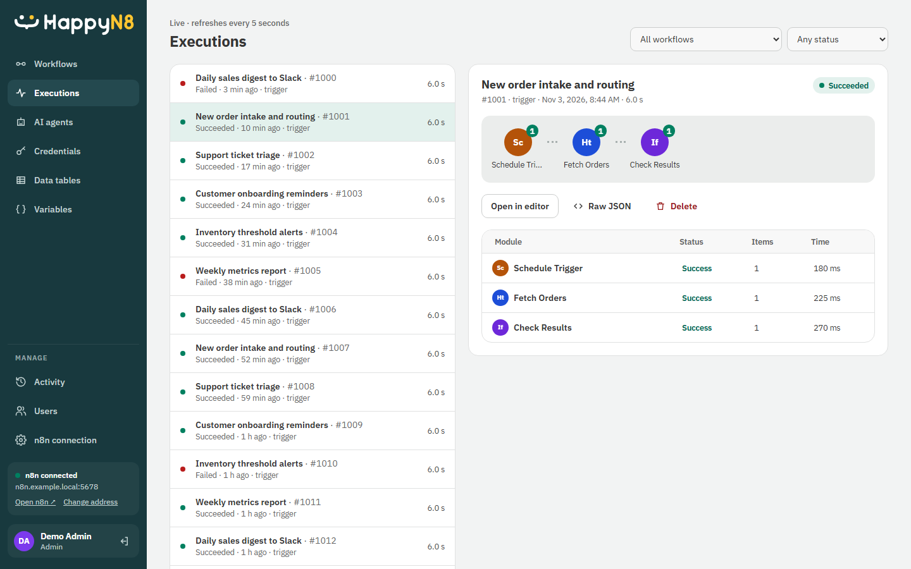

<p align="center">
  
</p>

<p align="center">
  A friendly, multi-user web front end for <a href="https://n8n.io">n8n</a>: browse, build and run workflows,<br>
  with its own users, roles and activity log.
</p>

---

## See it in action

These screenshots show HappyN8 connected to n8n with illustrative data. They do not show a real workspace.

**Find and manage workflows.** Browse runs and status, filter by app or trigger, and activate workflows from one place.



**Inspect executions.** See which modules ran, their status, item counts, and timing without opening the n8n owner account.



## What it is

HappyN8 sits in front of an existing n8n instance and talks to it through the n8n API. It gives a team a
simpler place to work with n8n without sharing the n8n owner account:

- **Workflows**: list, filter, organize, activate and open them in a visual editor (canvas, node picker,
  parameter forms, execution history and settings).
- **Executions**: browse runs and inspect each step's input and output.
- **AI agents, Credentials, Data tables, Variables**: dedicated pages for each.
- **Users and roles**: HappyN8 keeps its own accounts (`admin`, `editor`, `viewer`), separate from n8n.
- **Activity log**: who changed what and when, with configurable retention.
- **n8n connection**: admins can set or change the n8n address from the app.

## Architecture

```
browser ──► HappyN8 (Express, Node 22) ──► n8n REST API (+ optional n8n user session)
              │
              └── SQLite (node:sqlite): users, hashed passwords, activity log, settings
```

| Folder     | Contents |
|------------|----------|
| `server/`  | Express API, auth/sessions, n8n client and proxy, SQLite storage. See [server/README.md](server/README.md). |
| `web/`     | React 19 + Vite + TypeScript single-page app. See [web/README.md](web/README.md). |
| `scripts/` | `deploy.ps1` / `deploy.cmd` (Docker build and restart) and the brand asset generators. |

## Quick start (Docker)

Requirements: Docker with Compose, and an n8n instance with an API key
(n8n → Settings → n8n API → Create an API key).

```bash
cp .env.example .env      # then fill in the values (see below)
docker compose up -d --build
```

Open `http://<your-server>:45310` (or whatever `FLOWBOARD_PORT` you set) and sign in with
`ADMIN_USERNAME` / `APP_PASSWORD`. Change that password after the first sign-in.

On Windows you can use the helper instead. It checks Docker and `.env`, builds, and waits for the health check:

```powershell
.\scripts\deploy.ps1          # build / update and start
.\scripts\deploy.ps1 -Clean   # also prune old images
.\scripts\deploy.ps1 -Logs    # then follow the logs
```

Users, the activity log and the in-app n8n address are stored in the `flowboard-data` Docker volume, so they
survive rebuilds.

## Configuration

All configuration is read from environment variables (`.env` with Docker). See [.env.example](.env.example).

| Variable | Required | Description |
|----------|----------|-------------|
| `N8N_API_KEY` | yes | n8n API key. |
| `N8N_URL` | no | n8n address as seen from the HappyN8 container. Can also be set in the app (Manage → n8n connection). |
| `N8N_PUBLIC_URL` | no | Address the browser uses for "Open in n8n" links. Defaults to `N8N_URL`. |
| `N8N_EMAIL` / `N8N_PASSWORD` | no | An n8n user login. Unlocks the full node catalog with logos and forms, dynamic dropdowns, and "Run once" / "Test step". |
| `ADMIN_USERNAME` | no | Username of the first admin, created on first start. Default `admin`. |
| `APP_PASSWORD` | first start | Password for that first admin. |
| `SESSION_SECRET` | recommended | Long random string that signs sessions (`openssl rand -hex 32`). If unset, a random one is generated and sessions end on restart. |
| `SESSION_HOURS` | no | Session lifetime in hours. Default `168`. |
| `FLOWBOARD_PORT` | no | Host port HappyN8 is published on. Default `45310`. |
| `PORT` | no | Port the app listens on inside the container. Default `8080`. |
| `COOKIE_SECURE` | no | Set to `true` when served over HTTPS. |
| `AUDIT_RETENTION_DAYS` | no | How long the activity log is kept. Default `730`. |
| `DATA_DIR` / `DB_FILE` | no | Where the SQLite database lives. Docker uses `/data`. |

## Local development

Requirements: Node.js 22 or later (uses the built-in `node:sqlite`).

```bash
npm --prefix server install
npm --prefix web install

npm run dev:server   # API on http://localhost:8080 (reads ../.env)
npm run dev:web      # Vite on http://localhost:5173, proxies /api to the server
```

Build and test:

```bash
npm run build        # type-checks and builds web/dist
npm test             # server (node:test) + web (vitest)
```

## Security notes

- Never commit `.env`. It is gitignored, and `.env.example` holds placeholders only.
- Passwords are stored hashed. Sessions are HMAC-signed cookies, and disabling a user or changing their
  password revokes their sessions.
- Sign-in is rate limited per client.
- The n8n API key and n8n login stay on the server and are never sent to the browser.
- Put HappyN8 behind HTTPS (and set `COOKIE_SECURE=true`) if it is reachable beyond a trusted network.

## License

HappyN8 is available under the [PolyForm Noncommercial License 1.0.0](LICENSE.md). You may use, change, and share it for permitted noncommercial purposes. Commercial use requires separate permission from the project owner. This is a **source-available**, not an OSI-approved open-source, license.

This license covers HappyN8's own code and screenshots, not n8n or third-party dependencies. n8n has [separate license terms](https://support.n8n.io/article/can-i-use-your-license-for-my-use-case); giving people outside your organization access to build or configure n8n workflows through HappyN8 may require a commercial n8n license. Check the n8n terms for your deployment.
